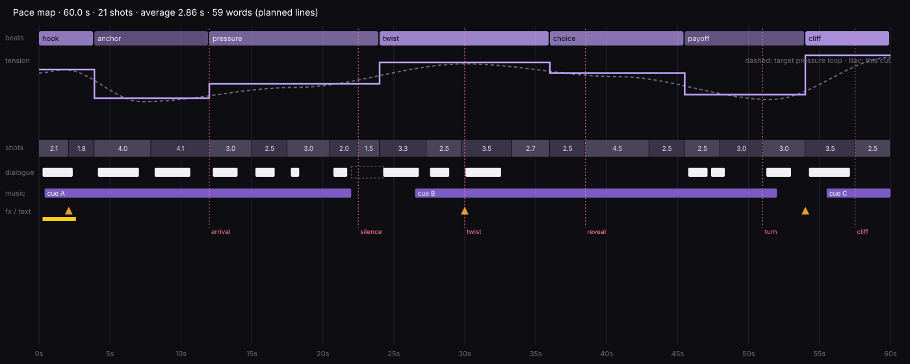

# Minisodes

A skill that teaches coding agents to make a **minisode**: a finished 1 to 2 minute micro-drama, comedy or
romance for social media, vertical by default. The user gives a concept and approves a 15 s trailer; the agent
writes the episode to the micro-drama format, plans it second by second like a director and cinematographer,
gray-boxes the locations, generates the cast sheets, location plates, keyframes and voices on fal, films 10-15 s
sequences with MiniMax H3 Max reference-to-video under a hard budget, reviews every take, cuts it with a measured
pacing pass, scores it, mixes it and delivers the master with captions.

It follows the shape of [video-to-game](https://github.com/larvuz2/video-to-game): the video model is good at what
an agent cannot do (performance, light, texture); the agent does what the model cannot (story structure,
continuity, references, timing, judgment), and proves every step with pictures and numbers because it cannot
watch video.

## How an episode is made

```text
concept + genre ──► trailer (H3 text-to-video, 15 s) ──► the user watches it, picks duration, format, budget
                                                              │
                       Claude Code routine on this repo ◄─────┘
  1 study the trailer      frames, palette, cuts: the look the user approved             study_video.py
  2 write the story        episode sheet: hook, recap, want, twist, choice, payoff, cliff  episode.json
  3 plan the shoot         sequences of 10-15 s, shots second by second, budget check      plan_check.py, pace.py --plan
  4 block out locations    gray Three.js set: furniture, actor marks, cameras, plan view   blockout.mjs
  5 build references       cast sheets, location plates, keyframes, Eleven v4 voices       make.py
  6 shoot and review       H3 reference-to-video, tagged refs, no music; contact sheets,   shoot.py, review_take.py
                           cut table, transcript vs script, verdicts, retakes
  7 edit                   edit list, J/L cuts, punch-ins, pace checks, cut sheet          pace.py, assemble.py
  8 score and mix          2-3 cues composed to the cut, effects, ducking, -14 LUFS        pace.py --music-plan, assemble.py
  9 deliver                final.mp4 + clean master + poster + report + pace map           report.py, shotforge_deliver.py
```

Every fal call goes through one ledger with a price table: a call that would pass the budget is refused before it
runs, and the report lists the spend per endpoint.

## What makes the episodes hold

- **The format is the contract.** A face in frame 1, hook text by 0.6 s, the first line by 2 s, the stakes by 5 s,
  a recap line in 20 s, a re-hook every 15-20 s, the turn near the middle, a cliffhanger as the last frame, lines
  of 8 words or fewer (from the Phatty Acid micro-drama format guide, adapted to 60-120 s:
  `skills/minisode/references/format.md`). `plan_check.py` refuses a plan that breaks it.
- **References are bound, not hoped for.** Character sheets (full-body turnaround on the left, big face
  close-ups on the right, outfit and accessory details), location plates rendered from the gray blockout so the
  geography never moves, keyframes for the hook, a voice sample per character. The prompt says what each tag is:
  "Image 1 is Nora's character sheet", "Audio 1 is Nora's voice".
- **Directed prompts.** Every sequence prompt opens with "No music." and lists its shots with time codes: size,
  angle, lens, move, behavior, the exact line, who says it, how, and in which voice. The look and the light are
  the same in every prompt.
- **Measured editing.** Average and median shot length, cuts per 10 s, the longest stretch without a change and
  without a re-hook, dead air, speech rate, the midpoint, the ending, loudness, all drawn on a pace map under the
  target pressure curve.



## The example

[`examples/plus-one/`](examples/plus-one/) is a complete plan for a 60 s romantic comedy: the episode sheet, 7
beats, 3 characters, 1 location with its blockout, 9 references with their recipes, 5 sequences of 13 s with 21
shots, 3 music cues, and the edit list. It passes every check of `plan_check.py` and `pace.py`, and its budget
table says 768P fits 9 USD with a 36 % retake reserve.

## Install

Claude Code (plugin marketplace):

```bash
claude plugin marketplace add larvuz2/minisodes
```

```bash
claude plugin install minisodes@minisodes
```

Or copy `skills/minisode` into your agent's skills folder (`~/.claude/skills/`, `~/.agents/skills/`...).

Needs Python 3.9+, ffmpeg with libass, `pip install fal-client` with a `FAL_KEY`, and for the blockout Node 18+
with Playwright and Chromium (`npm i three@0.160.0` to serve Three.js locally, else it loads from jsDelivr).

## Use

> Make a 60 s vertical minisode with the minisode skill from `trailer.mp4` (prompt in `trailer.txt`). Concept:
> "...". Genre: comedy. Budget 8 USD. Show me the plan check, the pace map and every kept take.

### From ShotForge

The Minisodes tab of ShotForge (the Phatty Acid app) writes and films the trailer, then "Generate minisode" fires a
Claude Code routine on this repository with the trailer, the settings and a delivery token. The session reports
each stage, shows previews (cast, locations, voices, takes, the pace map) and uploads the episode back.
Routine setup and saved prompt: [`prompts/shotforge-routine.md`](prompts/shotforge-routine.md). The tab's
contract: [`prompts/shotforge-minisodes-tab.md`](prompts/shotforge-minisodes-tab.md).

## Costs (fal, November 2026)

| | 480P | 768P | 1080P |
|---|---|---|---|
| H3 Max reference-to-video, per second | 0.05 | 0.08 | 0.16 |
| 60 s episode with references, score and a 25 % retake reserve | about 6 | about 8.3 | about 15.5 |

Sheets, plates and keyframes are 0.15 each (Nano Banana Pro), voices about 0.005 each (Eleven v4), the score 0.60
per minute (ElevenLabs Music) or 0.10 per cue (Lyria 3.5), transcripts about 0.01 per take. The ShotForge default
budget of 5 USD runs a 60 s episode in lean mode (480P, Lyria score, one plate, no retake reserve to speak of);
about 9 USD buys 768P with retakes.

## Layout

```text
skills/minisode/
  SKILL.md                 workflow, hard rules, reference routing
  references/              format, story, bible, blockout, shots, shoot-and-review, edit, sound
  scripts/                 fal_run.py (budget ledger), prompt.py, plan_check.py, make.py, shoot.py,
                           review_take.py, study_video.py, pace.py, assemble.py, report.py,
                           shotforge_deliver.py, blockout.mjs
  templates/               episode.json, layout.json, edit.json
examples/plus-one/         a complete 60 s plan, its blockout and its edit list
prompts/                   the ShotForge routine prompt and the Minisodes tab brief
docs/                      the micro-drama format guide (PDF)
tests/check_repo.py        static checks and the example's plan, prompt and pace checks
```

## Credits

The pipeline shape comes from [video-to-game](https://github.com/larvuz2/video-to-game) by Lovis Odin. The format
comes from the Phatty Acid micro-drama format guide. Models on [fal](https://fal.ai): MiniMax H3 Max, Nano Banana
Pro, ElevenLabs Eleven v4, Scribe v2, Music v2.5 and Sound Effects v2, Google Lyria 3.5.
